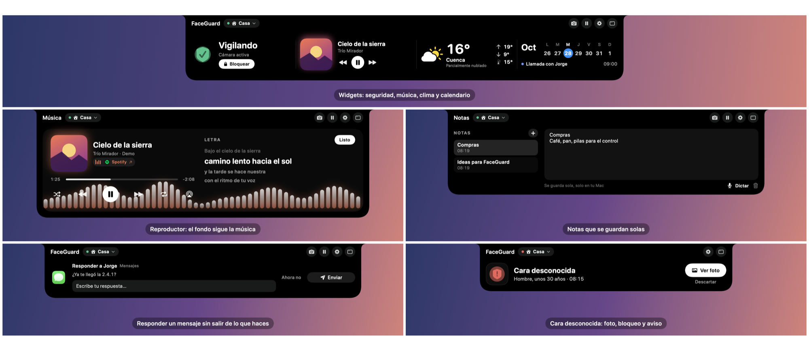

# FaceGuard · versiones

  
  

Aquí se publican los instaladores de **FaceGuard** y la lista de versiones (`appcast.xml`) que usan las
actualizaciones automáticas de la app. El código de FaceGuard no está aquí.

FaceGuard vigila con la cámara de tu Mac (todo se procesa en tu Mac): la bloquea cuando te vas, la abre
cuando vuelves, tapa la pantalla si alguien más la mira y protege tus apps con tu cara. En el notch tiene
además tu música con letra, el clima, el calendario, notas, una bandeja con AirDrop, respuestas rápidas a
tus mensajes, el volumen y el brillo, y lo que conectas (AirPods, mandos de PS4, PS5 o Xbox) con su batería.

Capturas con datos de ejemplo.

## Instalar

1. Descarga `FaceGuard-<versión>.pkg` de la [última versión](../../releases/latest).
2. Ábrelo. La app no está firmada con una cuenta de desarrollador de Apple: si macOS no la deja abrir, ve a
   **Ajustes del Sistema → Privacidad y seguridad** y toca **Abrir de todas formas**.
3. Después se actualiza sola: baja la versión nueva y la instala mientras no estás frente a la Mac. Se puede
   apagar en Ajustes → Comodidad.

Necesita una Mac con Apple Silicon y macOS 14 o más nuevo.

## Problemas

Desde la app: menú de FaceGuard → **Reportar un problema…** (o abajo en Ajustes). Se abre tu
correo con el mensaje listo y tú decides si enviarlo.

## Privacidad

Todo el reconocimiento corre en tu Mac. Si algo falla, y cuando FaceGuard se instala o se actualiza, se envía
un reporte técnico: la versión, el modelo de Mac, el chip, macOS y en qué parte del código pasó. Sin tu nombre,
sin el nombre de la Mac, sin IP ni ubicación, y nada de tu cara, tus fotos o lo que haces. No se guarda: solo se
reenvía por correo. Se apaga en Ajustes → Privacidad.

## Licencias

FaceGuard (MIT). Lleva dentro DynamicNotchKit (MIT), mediaremote-adapter (BSD-3-Clause), Sparkle (MIT),
YOLOX-tiny (Apache 2.0) y UniFace (MIT); los avisos van en la app, en `Contents/Resources/licencias`.
